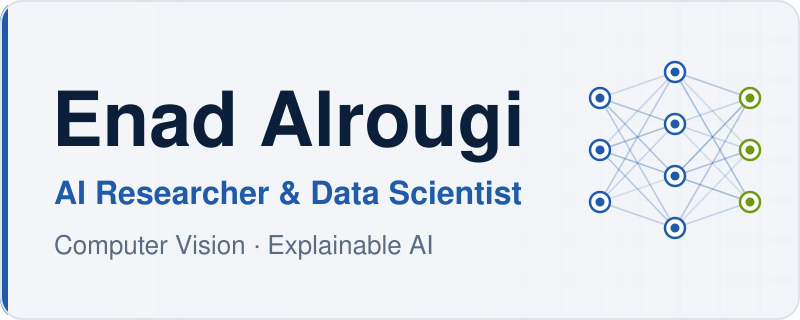
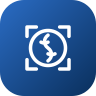
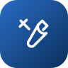

<picture><source media="(prefers-color-scheme: dark)" srcset="assets/header-dark.svg"></picture>

   

I build deep learning models for **early disease detection** and make their decisions **explainable**. MSc in Data Science (Taif University) and BSc in Artificial Intelligence (University of Jeddah). I care about honest evaluation: leak-free splits, clear baselines and reported limitations.

> *Keep working silently and you will succeed.*

##  Achievements

<table>
<tr>
<td width="50%" align="center">  <b>Peer-reviewed IEEE papers</b> Early Alzheimer's detection with deep learning and XAI</td>
<td width="50%" align="center">  <b>Alzheimer's detection app</b> Applied project, validated by neurologists</td>
</tr>
<tr>
<td width="50%" align="center">  <b>MSc Data Science</b> Taif University · BSc AI, University of Jeddah</td>
<td width="50%" align="center">  <b>Recommendation letters</b> Academic and professional</td>
</tr>
</table>

##  Publications

- **[Diagnosis of Alzheimer's Disease in Early Stages Using Deep Learning: An XAI and Ground Truth Analysis Approach](https://ieeexplore.ieee.org/document/11521152/)** IEEE · ICAIII 2026
- **[Leveraging Early Diagnosis of Alzheimer's Disease Using Deep Learning and XAI](https://ieeexplore.ieee.org/document/11341770/)** IEEE · FICAC 2025

##  Featured projects

<table>
<tr>
<td width="50%" valign="top"> <b><a href="https://github.com/IDE21/Visual-Pollution-Saudi-Roads">Visual Pollution · Saudi Roads</a></b> YOLO11s detector for potholes, barriers and damaged sidewalks. ✅ <b>mAP50 0.699</b> on a leak-free test split</td>
<td width="50%" valign="top"> <b><a href="https://github.com/IDE21/Multiple-Sclerosis-MS-Early-Diagnosis">MS Detection from Brain MRI</a></b> MobileNet transfer learning across 8 neurological classes. ✅ <b>96.6% accuracy</b> on 1,640 test images</td>
</tr>
<tr>
<td width="50%" valign="top"> <b><a href="https://github.com/IDE21/RAG-Pipeline-Development">RAG Pipeline + FastAPI</a></b> Scraping → e5 embeddings → FAISS → FLAN-T5 answers. ✅ <b>End-to-end</b> with an <code>/ask</code> API</td>
<td width="50%" valign="top"> <b><a href="https://github.com/IDE21/Alzheimers-app">Alzheimer's MRI App</a></b> Streamlit app that stages Alzheimer's from a brain MRI slice. ✅ <b>4 stages</b> · PyTorch ResNet18</td>
</tr>
<tr>
<td width="50%" valign="top"> <b><a href="https://github.com/IDE21/Alzheimer-classification-Numeric-dataset">Alzheimer's · Ensembles + XAI</a></b> XGBoost, LightGBM, CatBoost and ensembles on clinical data. ✅ <b>Explained</b> with SHAP and LIME</td>
<td width="50%" valign="top"> <b><a href="https://github.com/IDE21/LLM-Processing">NLP & LLM Notebooks</a></b> Transformer fine-tuning and Arabic sentiment analysis. ✅ <b>AraBERT</b> · Hugging Face</td>
</tr>
</table>

<b>More projects and bootcamp work</b>

- [Feature-Engineering](https://github.com/IDE21/Feature-Engineering): Chi², RFE and RF-importance feature selection compared
- [AdvanceML-Parkinson-s-Disease-Detection](https://github.com/IDE21/AdvanceML-Parkinson-s-Disease-Detection): voice-based Parkinson's classifiers
- [Discussion-Session-the-Depths-of-Data](https://github.com/IDE21/Discussion-Session-the-Depths-of-Data): workshop on EDA and ML basics
- [Scraping-web](https://github.com/IDE21/Scraping-web): Selenium + BeautifulSoup product scraper
- [Riyadh-weather](https://github.com/IDE21/Riyadh-weather): Bash + Python + cron weather pipeline
- [Analysing-bank-customers-data](https://github.com/IDE21/Analysing-bank-customers-data) · [Football-Dictionaries](https://github.com/IDE21/Football-Dictionaries) · [Warm-Up-Activities](https://github.com/IDE21/Warm-Up-Activities): SDA & INE bootcamp

##  Experience

| Year | Role |
|:-:|---|
| **2024** | **Amazon Web Services (AWS)** · Data Engineer (AWS Data Engineer Associate) Lambda and S3 pipelines, Apache Spark, cloud ETL |
| **2024** | **WeCloudData** · Data Engineer (16-week program) Python, AWS, Azure, big data and ML |
| **2023** | **Bayan · Data Science & AI** · Team Leader, previously Member Led the data team and workshops in Jeddah, Riyadh and Alkhobar |
| **2022** | **King Fahad Medical City** · Data Analyst Python, SQL and Power BI · improved data integrity by 30% |

##  Toolbox

   
   
  

- 🧠 **ML / DL:** PyTorch · TensorFlow/Keras · scikit-learn · XGBoost · LightGBM · CatBoost · Ultralytics YOLO
- 💬 **NLP / LLMs:** Hugging Face Transformers · sentence-transformers · FAISS · RAG · AraBERT
- 🔍 **Explainable AI:** SHAP · LIME
- ☁️ **Data & cloud:** pandas · Apache Spark · Databricks · Power BI · AWS · Azure
- 🚀 **Apps & scraping:** FastAPI · Streamlit · BeautifulSoup · Selenium

##  Let's connect

Open to research collaborations and data/AI projects. Reach me on [LinkedIn](https://www.linkedin.com/in/enad-alrougi-5b0a45253/) or through my [website](https://ide21.github.io).
