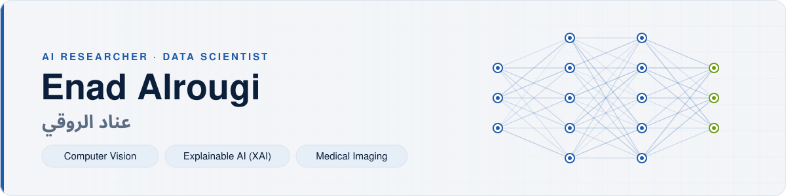
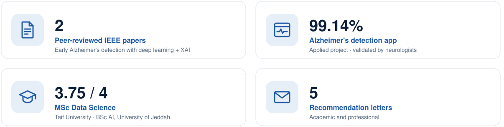
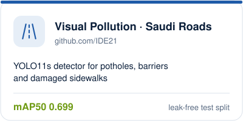
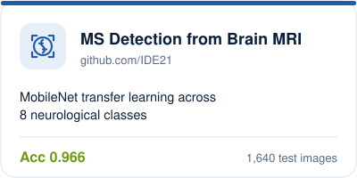
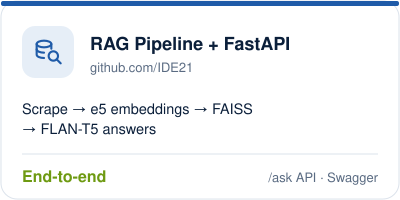
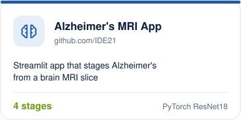
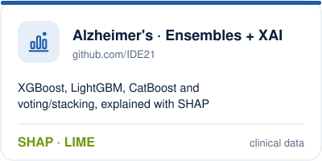
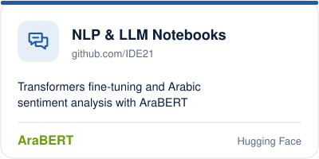
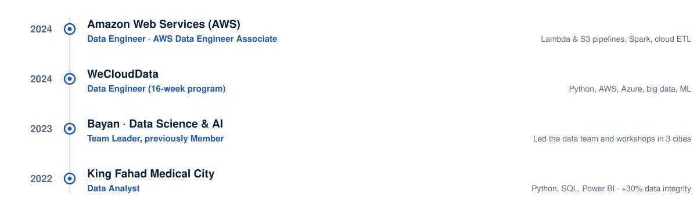

<picture><source media="(prefers-color-scheme: dark)" srcset="assets/banner-dark.svg"></picture>

   

I build deep learning models for **early disease detection** and make their decisions **explainable**. MSc in Data Science (Taif University) and BSc in Artificial Intelligence (University of Jeddah). I care about honest evaluation: leak-free splits, clear baselines and reported limitations.

> *Keep working silently and you will succeed.*

<picture><source media="(prefers-color-scheme: dark)" srcset="assets/h-achievements-dark.svg"></picture>

<picture><source media="(prefers-color-scheme: dark)" srcset="assets/achievements-dark.svg"></picture>

<picture><source media="(prefers-color-scheme: dark)" srcset="assets/h-publications-dark.svg"></picture>

| | Paper | Venue |
|:-:|---|:-:|
| 📄 | [**Diagnosis of Alzheimer's Disease in Early Stages Using Deep Learning: An XAI and Ground Truth Analysis Approach**](https://ieeexplore.ieee.org/document/11521152/) | IEEE · ICAIII 2026 |
| 📄 | [**Leveraging Early Diagnosis of Alzheimer's Disease Using Deep Learning and XAI**](https://ieeexplore.ieee.org/document/11341770/) | IEEE · FICAC 2025 |

<picture><source media="(prefers-color-scheme: dark)" srcset="assets/h-projects-dark.svg"></picture>

<a href="https://github.com/IDE21/Visual-Pollution-Saudi-Roads"><picture><source media="(prefers-color-scheme: dark)" srcset="assets/project-pollution-dark.svg"></picture></a>
<a href="https://github.com/IDE21/Multiple-Sclerosis-MS-Early-Diagnosis"><picture><source media="(prefers-color-scheme: dark)" srcset="assets/project-ms-dark.svg"></picture></a>
<a href="https://github.com/IDE21/RAG-Pipeline-Development"><picture><source media="(prefers-color-scheme: dark)" srcset="assets/project-rag-dark.svg"></picture></a>

<a href="https://github.com/IDE21/Alzheimers-app"><picture><source media="(prefers-color-scheme: dark)" srcset="assets/project-alz-app-dark.svg"></picture></a>
<a href="https://github.com/IDE21/Alzheimer-classification-Numeric-dataset"><picture><source media="(prefers-color-scheme: dark)" srcset="assets/project-alz-xai-dark.svg"></picture></a>
<a href="https://github.com/IDE21/LLM-Processing"><picture><source media="(prefers-color-scheme: dark)" srcset="assets/project-nlp-dark.svg"></picture></a>

<b>More projects and bootcamp work</b>

- [Feature-Engineering](https://github.com/IDE21/Feature-Engineering): Chi², RFE and RF-importance feature selection compared
- [AdvanceML-Parkinson-s-Disease-Detection](https://github.com/IDE21/AdvanceML-Parkinson-s-Disease-Detection): voice-based Parkinson's classifiers
- [Discussion-Session-the-Depths-of-Data](https://github.com/IDE21/Discussion-Session-the-Depths-of-Data): workshop on EDA and ML basics
- [Scraping-web](https://github.com/IDE21/Scraping-web): Selenium + BeautifulSoup product scraper
- [Riyadh-weather](https://github.com/IDE21/Riyadh-weather): Bash + Python + cron weather pipeline
- [Analysing-bank-customers-data](https://github.com/IDE21/Analysing-bank-customers-data) · [Football-Dictionaries](https://github.com/IDE21/Football-Dictionaries) · [Warm-Up-Activities](https://github.com/IDE21/Warm-Up-Activities): SDA & INE bootcamp

<picture><source media="(prefers-color-scheme: dark)" srcset="assets/h-experience-dark.svg"></picture>

<picture><source media="(prefers-color-scheme: dark)" srcset="assets/experience-dark.svg"></picture>

<picture><source media="(prefers-color-scheme: dark)" srcset="assets/h-toolbox-dark.svg"></picture>

   
  

| Area | Tools |
|---|---|
| 🧠 ML / DL | PyTorch · TensorFlow/Keras · scikit-learn · XGBoost · LightGBM · CatBoost · Ultralytics YOLO |
| 💬 NLP / LLMs | Hugging Face Transformers · sentence-transformers · FAISS · RAG · AraBERT |
| 🔍 Explainable AI | SHAP · LIME |
| ☁️ Data & cloud | pandas · Apache Spark · Databricks · Power BI · AWS · Azure |
| 🚀 Apps & scraping | FastAPI · Streamlit · BeautifulSoup · Selenium |

<picture><source media="(prefers-color-scheme: dark)" srcset="assets/h-connect-dark.svg"></picture>

Open to research collaborations and data/AI projects. The best place to reach me is [LinkedIn](https://www.linkedin.com/in/enad-alrougi-5b0a45253/) or my [website](https://ide21.github.io).
